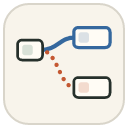
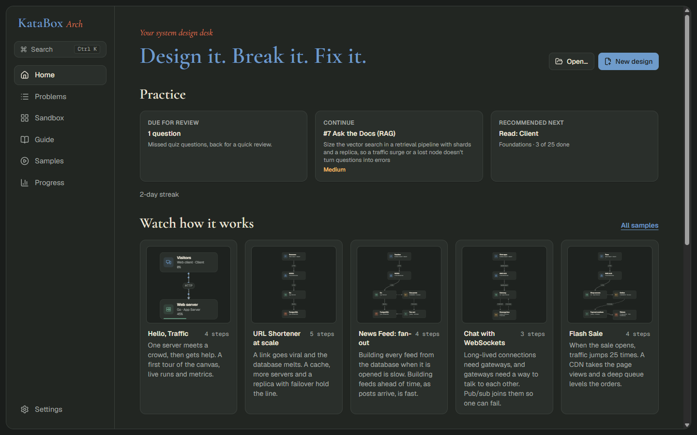
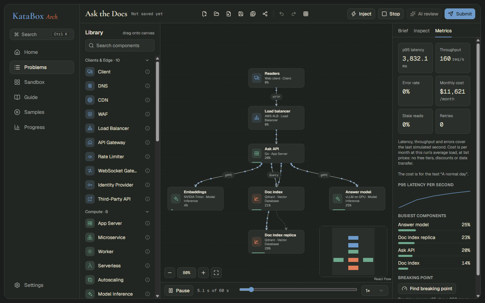
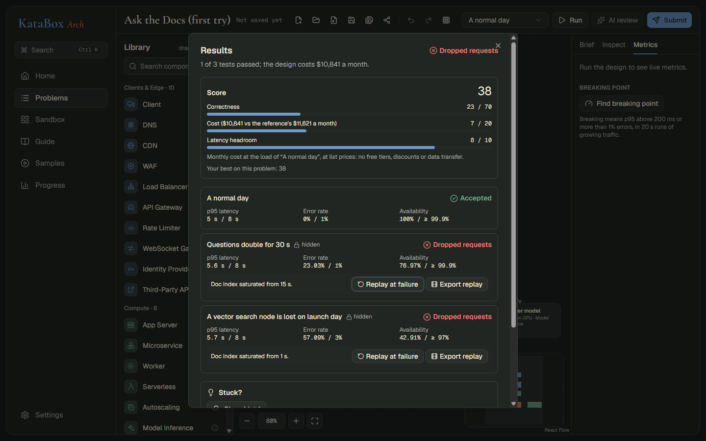
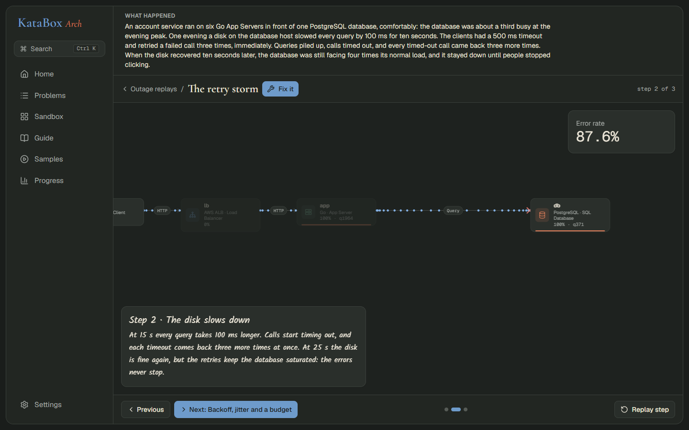
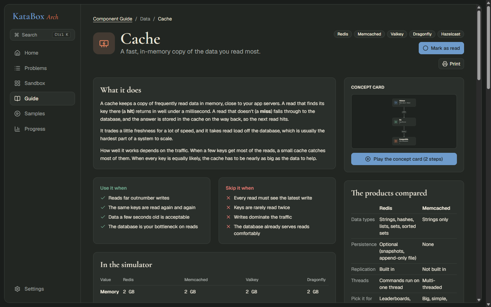
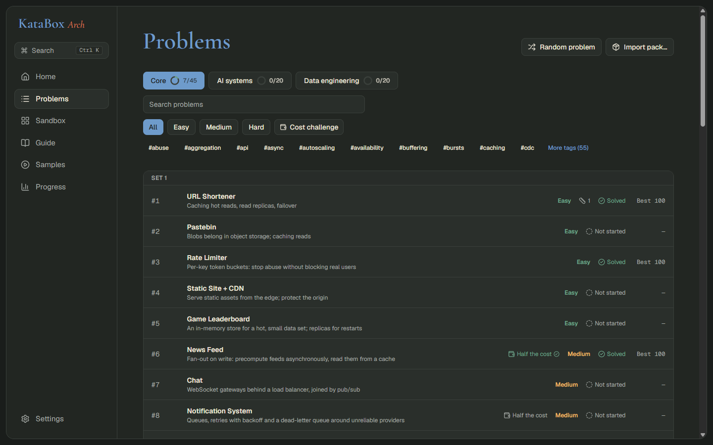

# KataBox Arch



**Práctica de diseño de sistemas en tu escritorio, al estilo LeetCode.** KataBox Arch es un entorno libre, de código abierto y sin conexión para practicar diseño de sistemas. Arrastras componentes reales a un lienzo (PostgreSQL, Redis, Kafka, NGINX, S3 y muchos más, con sus nombres de producto reales), los conectas y ejecutas una simulación de tráfico determinista que anima cada petición. Después envías el diseño y unas pruebas ocultas lo califican según los objetivos de latencia, disponibilidad y coste del problema.

[English](README.md)

> **Estado:** versión previa (0.1.0), solo para Windows. Aún no hay instalador para descargar, así que hay que [compilarla desde el código](#compilar-desde-el-código). Linux está previsto. KataBox Arch es el proyecto hermano de [KataBox](https://github.com/kaspal/katabox), práctica de programación sin conexión.

## Funciones

- **42 tipos de componente en 162 variantes de producto:** clientes, DNS, CDN, balanceadores de carga, API gateways, servidores de aplicaciones, colas, streams, bases de datos SQL y NoSQL, cachés, almacenamiento de objetos, búsqueda, inferencia de modelos, almacenes vectoriales, data warehouses y lakehouses, entre otros. Regiones, zonas de disponibilidad, grupos de autoescalado y notas adhesivas enmarcan el diseño, y las reglas de conexión explican cada conexión que rechazan.
- **85 problemas en tres áreas:** Básico (45, en los Sets 1–3, de un acortador de URL a la detección de fraude en pagos), Sistemas de IA (20) e Ingeniería de datos (20). 27 fáciles, 31 de dificultad media y 27 difíciles. Cada uno trae un enunciado con objetivos, pruebas visibles y ocultas, tres pistas y una solución comentada.
- **20 repeticiones de caídas:** observa paso a paso cómo se desarrolla un tipo de incidente real (una tormenta de reintentos, una estampida de caché, un split brain, un cambio de configuración erróneo), luego arréglalo y envía tu solución. Cada una enlaza a informes públicos de incidentes reales (39 en total).
- **10 ejercicios «Encuentra el fallo»:** diseños que parecen correctos y aguantan un día normal, pero tienen un fallo que una prueba deja al descubierto.
- **El simulador:** determinista, con cada petición dibujada como un paquete en movimiento y cada tarjeta mostrando su carga. Inyecta fallos mientras se ejecuta (tumbar una tarjeta, ralentizarla, vaciar una caché, triplicar el tráfico). Modela la conmutación por error, el retraso de replicación y las lecturas obsoletas, los reintentos y timeouts de los clientes, los circuit breakers, el descarte de carga y el autoescalado. **Buscar el punto de ruptura** averigua cuánto tráfico aguanta un diseño, y los costes salen de precios de lista citados.
- **El juez:** pruebas ocultas con picos, nodos caídos y claves calientes; una puntuación sobre 100 por corrección, coste y margen de latencia; **Repetir desde el fallo** salta al momento en que falló una prueba, también las ocultas; y, una vez resuelto, **Comparar con la referencia** y un gráfico de coste frente a velocidad de tus diseños aceptados.
- **«El mismo SLO por la mitad de coste»:** 30 problemas tienen un reto de coste que se abre al resolverlos: vuelve a pasar todas las pruebas con la mitad del presupuesto de la referencia (o entre un 20 y un 45 % menos, donde la mitad no es posible).
- **Aprender:** la Guía de componentes (42 entradas, 18 con una tarjeta de concepto animada), 10 patrones, 4 guías de decisión, un glosario de 62 términos, una chuleta de números con 43 cifras y 5 ejemplos guiados.
- **Practicar:** 8 itinerarios, 156 preguntas de repaso con repetición espaciada de las que fallas y 246 ejercicios de estimación a ojo de buen cubero.
- **Paquetes de problemas:** comparte colecciones de problemas como archivos `.kbpack`. Un paquete solo contiene texto y diseños, y cada importación se comprueba primero (sumas de verificación, tamaños, marcado) y se califica antes de instalar nada.
- **Exportar:** imágenes PNG y SVG, un vídeo WebM de una ejecución, diagramas Mermaid y la Guía impresa en PDF o en HTML listo para imprimir.
- **Importa un `docker-compose.yml`** como diseño de partida.
- **Accesibilidad:** conexiones con el teclado, alto contraste, movimiento reducido y colores que siempre van con un icono o una etiqueta.
- **Dos idiomas de interfaz:** inglés y español, incluidos todos los problemas, pistas y entradas de la Guía.

## Capturas de pantalla













Las capturas muestran la interfaz en inglés; la app también está en español.

## Cómo funciona

1. **Diseña:** elige un problema, lee sus objetivos y construye un diseño en el lienzo.
2. **Ejecuta:** reproduce una prueba en vivo y mira dónde se acumulan, se ralentizan o fallan las peticiones.
3. **Califica:** envía el diseño; se ejecutan todas las pruebas, también las ocultas, y recibes un veredicto por prueba y una puntuación.
4. **Aprende:** las pistas, la solución comentada, la Guía y el diseño de referencia muestran lo que se te escapó.

La simulación es determinista: el mismo diseño con la misma semilla da siempre el mismo resultado, en cualquier equipo. También está simplificada a propósito. Cada cifra que usa es una cita, una regla práctica o una decisión de modelado, y [docs/calibration.md](docs/calibration.md) indica cuál (en inglés).

## Requisitos del sistema

- **Windows 10 u 11 de 64 bits (x64).**
- **WebView2.** Viene con Windows 10 y 11.
- **Espacio en disco:** unos 16 MB (la app y su contenido integrado).

Linux aún no está disponible.

## Compilar desde el código

Necesitas Rust (estable, 1.99 o posterior; consulta `rust-toolchain.toml`), Node 22 o posterior y pnpm 10.

```sh
pnpm install
pnpm dev               # ejecutar la app
cargo test             # pruebas de Rust
pnpm test              # pruebas de la interfaz
pnpm release:build     # generar los instaladores
```

Las compilaciones no llevan firma de código, así que Windows SmartScreen puede mostrar «Windows protegió su PC» al ejecutar un instalador que hayas generado. Pulsa **Más información** y luego **Ejecutar de todas formas**.

[docs/development.md](docs/development.md) describe la estructura del proyecto y todas las comprobaciones (en inglés).

## Dónde se guardan tus datos

| Qué | Dónde |
| --- | --- |
| Tu progreso, envíos, borradores, repasos, ajustes y archivos recientes (`user.db`), los paquetes de problemas instalados (`packs\`) y una copia de seguridad de `user.db` hecha antes de cada actualización de su formato | `%APPDATA%\dev.katabox.arch` |
| Los datos propios de la vista web (WebView2) | `%LOCALAPPDATA%\dev.katabox.arch` |

Tus diseños `.kbarch` están donde los guardes. Las compilaciones de desarrollo guardan sus datos en carpetas aparte terminadas en `-dev` y muestran la etiqueta **DEV DATA**.

## Sin conexión y privada

- KataBox Arch funciona totalmente sin conexión. No hace ninguna petición de red mientras se ejecuta.
- Sin telemetría, sin cuenta y sin comprobación de actualizaciones.
- Previsto: una revisión de tu diseño con IA. Será opcional, usará tu propia clave con el proveedor que elijas y nunca cambiará una puntuación.

## Documentación

- [Guía de usuario](docs/user-guide.es.md) ([in English](docs/user-guide.md))
- [Cómo crear problemas](docs/problem-authoring.md) (en inglés)
- [Cómo crear paquetes](docs/pack-authoring.md) (en inglés)
- [Calibración: cada cifra y su fuente](docs/calibration.md) (en inglés)
- [Problemas conocidos](docs/known-issues.md) (en inglés)
- [Empaquetado](docs/packaging.md) (en inglés)
- [Notas para Linux (WebKitGTK)](docs/linux-webkitgtk.md) (en inglés)
- [Registro de cambios](CHANGELOG.md) (en inglés)

## Marcas

Los nombres de productos que aparecen como variantes pertenecen a sus dueños; KataBox Arch no está afiliada a ellos.

## Licencia

- Código: [MIT](LICENSE-MIT) o [Apache-2.0](LICENSE-APACHE), a tu elección.
- Problemas, Guía y demás contenido (`content/`): [CC BY-SA 4.0](https://creativecommons.org/licenses/by-sa/4.0/deed.es).
- Avisos de terceros: [docs/third-party-notices.md](docs/third-party-notices.md); las compilaciones de publicación incluyen los textos completos de las licencias (`pnpm notices`).
