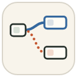
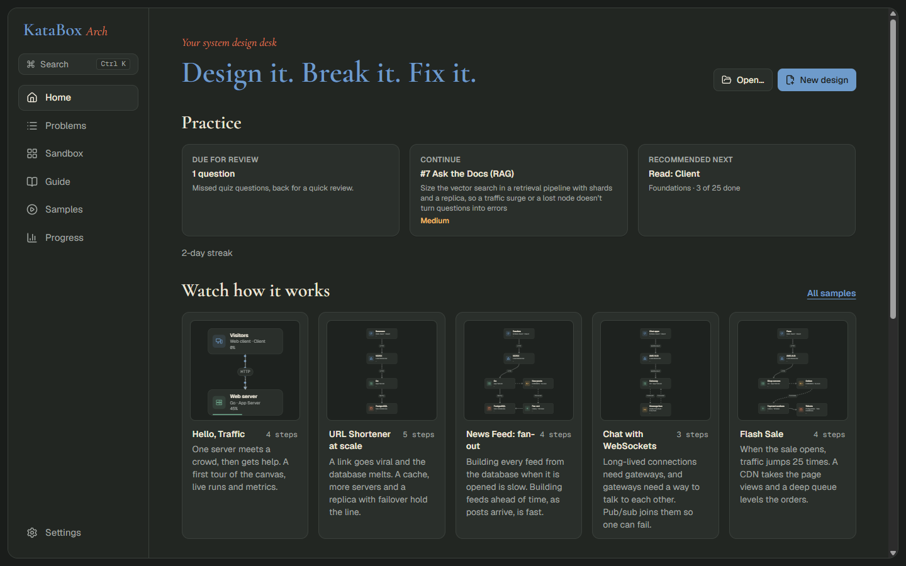
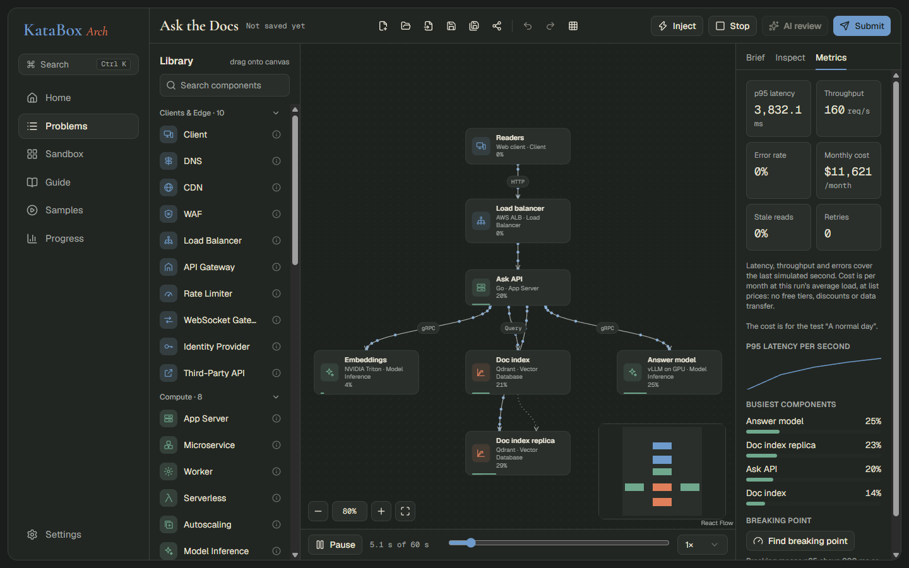
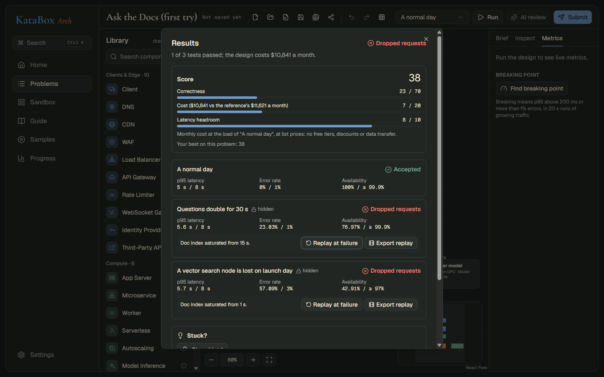
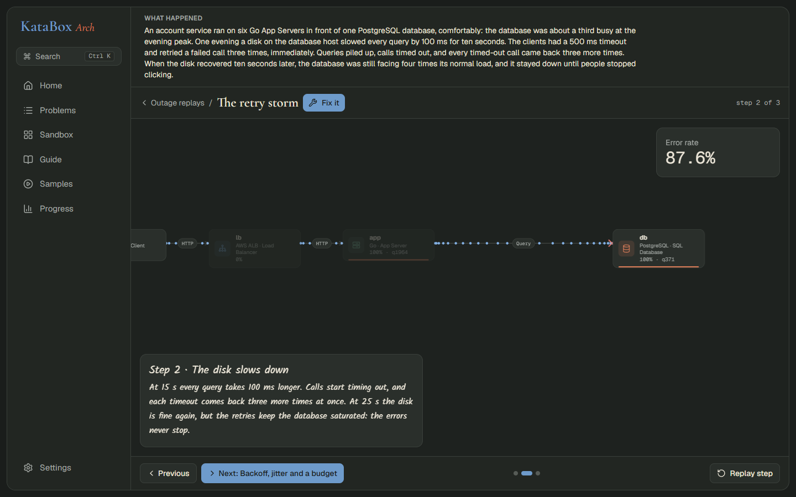
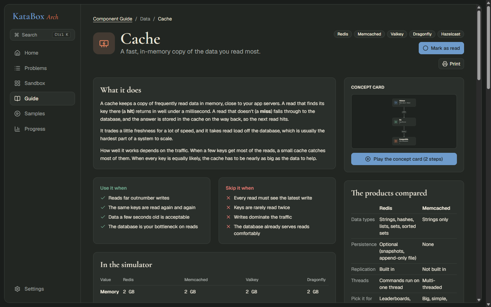
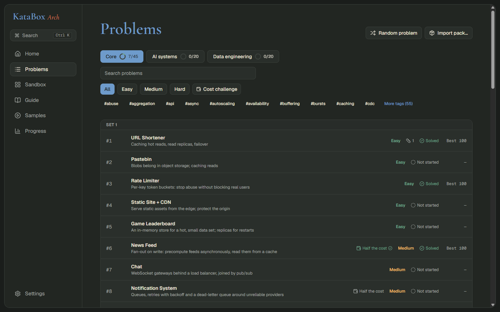

# KataBox Arch



**System design practice for your desktop, LeetCode style.** KataBox Arch is a free, open-source, offline playground for system design. You drag real components onto a canvas (PostgreSQL, Redis, Kafka, NGINX, S3 and many more, by their real product names), wire them, and run a deterministic traffic simulation that animates every request. Then you submit, and hidden tests judge your design against the problem's targets for latency, availability and cost.

[Leer en español](README.es.md)

> **Status:** pre-release (0.1.0), Windows only. There is no downloadable installer yet, so [build it from source](#build-from-source). Linux is planned. KataBox Arch is the sister project of [KataBox](https://github.com/kaspal/katabox), offline coding practice.

## Features

- **42 component kinds in 162 product flavours:** clients, DNS, CDNs, load balancers, API gateways, app servers, queues, streams, SQL and NoSQL databases, caches, object storage, search, model inference, vector stores, warehouses and lakehouses, among others. Regions, availability zones, autoscaling groups and sticky notes frame the design, and the wiring rules explain every connection they refuse.
- **85 problems in three tracks:** Core (45, in Sets 1–3, from a URL Shortener to Payment Fraud Scoring), AI systems (20) and Data engineering (20). 27 easy, 31 medium and 27 hard. Each has a brief with targets, visible and hidden tests, three hints and an editorial.
- **20 outage replays:** watch a real kind of incident (a retry storm, a cache stampede, split brain, a bad config push) unfold step by step, then fix it and submit the fix. Each links to real public postmortems (39 in all).
- **10 "Find the flaw" drills:** designs that look fine and pass a normal day, each with one flaw a test exposes.
- **The simulator:** deterministic, with every request drawn as a moving packet and each card showing its load. Inject chaos while it runs (kill a card, slow it down, flush a cache, triple the traffic). It models failover, replication lag and stale reads, client retries and timeouts, circuit breakers, load shedding and autoscaling. **Find breaking point** finds how much traffic a design holds, and costs come from cited list prices.
- **The judge:** hidden tests for spikes, dead nodes and hot keys; a score out of 100 for correctness, cost and latency headroom; **Replay at failure** jumps to the moment a test broke, hidden ones included; once solved, **Compare with reference** and a cost-against-speed chart of your accepted designs.
- **"Same SLO, half the cost":** 30 problems have a cost challenge that unlocks once you solve them: pass every test again on half the reference's budget (or 20–45% less, where half can't be done).
- **Learn:** the Component Guide (42 entries, 18 with an animated concept card), 10 patterns, 4 decision guides, a glossary of 62 terms, a numbers cheat sheet of 43 figures and 5 guided walkthrough samples.
- **Practice:** 8 learning paths, 156 quiz questions with spaced review of the ones you miss, and 246 back-of-the-envelope estimation drills.
- **Problem packs:** share problem sets as `.kbpack` files. A pack holds only text and designs, and every import is checked first (checksums, sizes, markup) and judged before anything is installed.
- **Export:** PNG and SVG images, a WebM video of a run, Mermaid diagrams, and the Guide printed to PDF or print-ready HTML.
- **Import a `docker-compose.yml`** as a starting design.
- **Accessibility:** keyboard wiring, high contrast, reduced motion, and colours that always come with an icon or a label.
- **Two interface languages:** English and Spanish, including every problem, hint and Guide entry.

## Screenshots













## How it works

1. **Design:** pick a problem, read its targets, and build a design on the canvas.
2. **Run:** play a test live and watch where the requests queue up, slow down or fail.
3. **Judge:** submit; every test runs, hidden ones included, and you get a verdict per test and a score.
4. **Learn:** hints, the editorial, the Guide and the reference design show what you missed.

The simulation is deterministic: the same design and the same seed always give the same result, on every machine. It is also simplified on purpose. Every figure it uses is either cited, a rule of thumb, or a modelling choice, and [docs/calibration.md](docs/calibration.md) says which.

## System requirements

- **Windows 10 or 11, 64-bit (x64).**
- **WebView2.** It comes with Windows 10 and 11.
- **Disk space:** about 16 MB (the app and its built-in content).

Linux is not available yet.

## Build from source

You need Rust (stable, 1.99 or later; see `rust-toolchain.toml`), Node 22 or later, and pnpm 10.

```sh
pnpm install
pnpm dev               # run the app
cargo test             # Rust tests
pnpm test              # UI tests
pnpm release:build     # build the installers
```

Builds are not code-signed, so Windows SmartScreen may show "Windows protected your PC" when you run an installer you built. Click **More info**, then **Run anyway**.

[docs/development.md](docs/development.md) has the workspace layout and every check.

## Where your data lives

| What | Where |
| --- | --- |
| Your progress, submissions, drafts, quiz reviews, settings and recent files (`user.db`), installed problem packs (`packs\`), and a backup of `user.db` taken before each upgrade of its format | `%APPDATA%\dev.katabox.arch` |
| The web view's own data (WebView2) | `%LOCALAPPDATA%\dev.katabox.arch` |

Your `.kbarch` designs live wherever you save them. Development builds keep their data in separate folders ending in `-dev` and show a **DEV DATA** badge.

## Offline and private

- KataBox Arch works fully offline. It makes no network requests at runtime.
- No telemetry, no account, no update checks.
- Planned: an AI review of your design. It will be opt-in, use your own key with the provider you choose, and never change a score.

## Documentation

- [User guide](docs/user-guide.md) ([en español](docs/user-guide.es.md))
- [Problem authoring](docs/problem-authoring.md)
- [Pack authoring](docs/pack-authoring.md)
- [Calibration: every figure and its source](docs/calibration.md)
- [Known issues](docs/known-issues.md)
- [Packaging](docs/packaging.md)
- [Linux notes (WebKitGTK)](docs/linux-webkitgtk.md)
- [Changelog](CHANGELOG.md)

## Trademarks

Product names shown as component flavours belong to their owners; KataBox Arch is not affiliated with them.

## License

- Code: [MIT](LICENSE-MIT) or [Apache-2.0](LICENSE-APACHE), at your option.
- Problems, Guide and other content (`content/`): [CC BY-SA 4.0](https://creativecommons.org/licenses/by-sa/4.0/).
- Third-party notices: [docs/third-party-notices.md](docs/third-party-notices.md); release builds bundle the full licence texts (`pnpm notices`).
